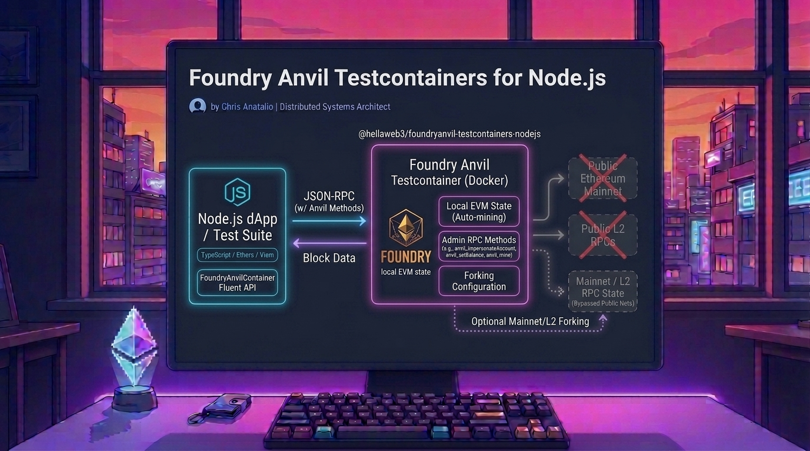
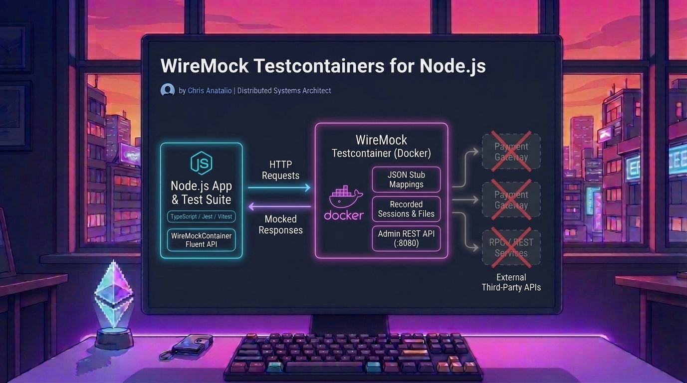

  <h2>Building the Foundation for Reliable Web3 Development</h2>
  

    At Hella Labs, we don't just talk about quality and security—we build the tools that make them achievable. Our open-source contributions reflect our core engineering philosophy: <strong>complex systems demand robust testing infrastructure</strong>.
  

In an industry where smart contract vulnerabilities can cost millions and API failures can halt operations, we've created test automation tools that development teams rely on daily. These aren't side projects—they're **production-grade solutions** born from real-world challenges in Web3 and enterprise software development.

---

## Our Open Source Projects

  

    
  

  

    <h3>
      <a href="/open-source/foundry-anvil-testcontainers/">Foundry Anvil Testcontainers for Node.js</a>
    </h3>
    

      <strong>Enterprise-grade test automation for Ethereum smart contract development.</strong>
    

    

      Spin up isolated Foundry Anvil instances in seconds for truly reproducible blockchain testing. Zero configuration, full Testcontainers integration, and CI/CD ready out of the box.
    

    <ul class="project-highlights">
      <li><i class="fa-solid fa-check-circle"></i> <strong>80% reduction</strong> in test setup time</li>
      <li><i class="fa-solid fa-check-circle"></i> Near-zero flaky tests from environment drift</li>
      <li><i class="fa-solid fa-check-circle"></i> Full TypeScript support with Viem integration</li>
    </ul>
    

      <a href="https://github.com/hella-web3/foundryanvil-testcontainers-nodejs" target="_blank" rel="noopener">
        <i class="fa-brands fa-github"></i> GitHub
      </a>
      <a href="https://www.npmjs.com/package/@hellaweb3/foundryanvil-testcontainers-nodejs" target="_blank" rel="noopener">
        <i class="fa-brands fa-npm"></i> NPM
      </a>
      <a href="/open-source/foundry-anvil-testcontainers/" class="button button--small">
        Learn More →
      </a>
    

  

  

    
  

  

    <h3>
      <a href="/open-source/wiremock-testcontainers/">WireMock Testcontainers for Node.js</a>
    </h3>
    

      <strong>Professional API mocking for reliable integration testing.</strong>
    

    

      Container-isolated WireMock instances that eliminate dependencies on external services. Test payment integrations, authentication flows, and third-party APIs with complete control and zero flakiness.
    

    <ul class="project-highlights">
      <li><i class="fa-solid fa-check-circle"></i> <strong>90% faster</strong> integration test execution</li>
      <li><i class="fa-solid fa-check-circle"></i> Complete isolation from external services</li>
      <li><i class="fa-solid fa-check-circle"></i> Flexible stub registration and verification</li>
    </ul>
    

      <a href="https://github.com/hella-web3/wiremock-testcontainers-nodejs" target="_blank" rel="noopener">
        <i class="fa-brands fa-github"></i> GitHub
      </a>
      <a href="https://www.npmjs.com/package/@hellaweb3/wiremock-testcontainers-nodejs" target="_blank" rel="noopener">
        <i class="fa-brands fa-npm"></i> NPM
      </a>
      <a href="/open-source/wiremock-testcontainers/" class="button button--small">
        Learn More →
      </a>
    

  

---

## Why This Demonstrates Our Excellence

  

    

      <i class="fa-solid fa-shield-halved"></i>
    

    <h3>Quality is Non-Negotiable</h3>
    
These tools exist because we've seen the cost of inadequate testing firsthand. We build infrastructure that makes comprehensive testing practical, not aspirational.

  

  

    

      <i class="fa-solid fa-lock"></i>
    

    <h3>Security Through Reliability</h3>
    
Reproducible tests in isolated environments mean vulnerabilities get caught before deployment. No shared state, no race conditions, no surprises in production.

  

  

    

      <i class="fa-solid fa-code"></i>
    

    <h3>Engineering Depth</h3>
    
Creating developer tools requires understanding not just the technical implementation, but the workflows, pain points, and cognitive load of the teams using them.

  

  

    

      <i class="fa-solid fa-users"></i>
    

    <h3>Community Investment</h3>
    
We contribute these tools freely because rising tides lift all boats. A stronger testing ecosystem means more secure applications for everyone.

  

---

## What This Means for Your Project

  

    If we can build test automation tools that:
  

  <ul>
    <li>Eliminate flaky tests across distributed blockchain networks</li>
    <li>Integrate seamlessly with modern CI/CD pipelines</li>
    <li>Handle the complexity of containerized environments</li>
    <li>Support teams building mission-critical Web3 applications</li>
  </ul>
  

    <strong>Imagine what we can do when we focus exclusively on your specific challenges.</strong>
  

---

## Our Service Offerings

The engineering principles behind these open-source tools power our consulting services:

  

    <i class="fa-solid fa-code"></i>
    <h3>DevOps & Test Automation</h3>
    
Comprehensive testing strategies, CI/CD pipeline optimization, and infrastructure automation that scales with your team.

  

  

    <i class="fa-brands fa-ethereum"></i>
    <h3>Web3 Development</h3>
    
Smart contract development, dApp front-ends, and blockchain integration with security and testing built-in from day one.

  

  

    <i class="fa-solid fa-users-gear"></i>
    <h3>Technical Leadership</h3>
    
Fractional CTO services, architecture review, and engineering process optimization for startups and scale-ups.

  

  

    <i class="fa-solid fa-pen-nib"></i>
    <h3>Developer Relations & Technical Content</h3>
    
Turn complex technical achievements into compelling narratives that resonate with developer communities.

  

  <a href="/web3-consultant-service-offerings/" class="button button--secondary">Explore All Services →</a>

---

  <h3>Ship with confidence.</h3>
  
Our automation strategies and Web3 expertise reduce your time-to-market while increasing the reliability of your protocol. Whether you're launching a new project or scaling existing infrastructure, we bring Silicon Valley expertise with global cost-effectiveness.

  <a href="/contact/" class="button button--primary">Get a DevOps Audit</a>

