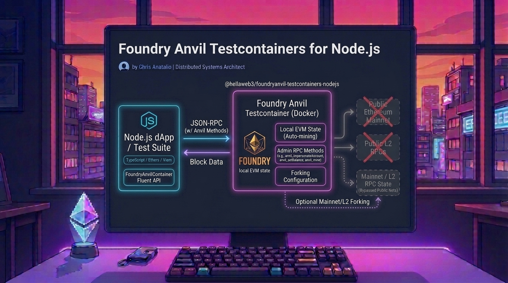

<div class="project-icon-header">
  <i class="fa-brands fa-ethereum glow-icon"></i>
  <h1>Foundry Anvil Testcontainers for Node.js</h1>
  <hr class="header-divider">
</div>

<div class="project-hero">
  
</div>

## Overview

The **Foundry Anvil Testcontainers NodeJS Module** brings enterprise-grade test automation to Web3 development. This powerful module provides seamless integration between Testcontainers and Foundry's Anvil local Ethereum node, enabling developers to run isolated, reproducible integration tests for smart contracts and decentralized applications.

<div class="project-badges">
  <a href="https://github.com/hella-web3/foundryanvil-testcontainers-nodejs" target="_blank" rel="noopener">
    
  </a>
  <a href="https://www.npmjs.com/package/@hellaweb3/foundryanvil-testcontainers-nodejs" target="_blank" rel="noopener">
    
  </a>
  
</div>

### Key Features

- **Zero Configuration Setup** - Spin up isolated Anvil instances with a single line of code
- **Full Testcontainers Integration** - Leverages the battle-tested Testcontainers framework
- **Parallel Test Execution** - Run multiple test suites simultaneously with isolated blockchain states
- **CI/CD Ready** - Works seamlessly in GitHub Actions, GitLab CI, and other automation pipelines
- **TypeScript Support** - Fully typed for enhanced developer experience
- **Custom Network Configuration** - Configure block time, chain ID, and other network parameters
- **Snapshot & Forking Support** - Test against mainnet forks or custom blockchain snapshots

<hr class="section-divider">

## Why This Matters

In the rapidly evolving Web3 ecosystem, **quality and security are non-negotiable**. Smart contract bugs can lead to millions in losses. Our Foundry Anvil Testcontainers module reflects our commitment to building tools that:

- **Eliminate Environment Drift** - Every test runs in a pristine, identical environment
- **Accelerate Development Cycles** - Developers spend less time on test setup and more time building
- **Improve Test Reliability** - Consistent, reproducible tests mean fewer false positives
- **Enable Continuous Testing** - Seamless CI/CD integration ensures quality at every commit

<hr class="section-divider">

## Installation

```bash
npm install @hellaweb3/foundryanvil-testcontainers-nodejs
```

or

```bash
yarn add @hellaweb3/foundryanvil-testcontainers-nodejs
```

## Quick Start

```javascript
import { FoundryAnvilContainer } from '@hellaweb3/foundryanvil-testcontainers-nodejs';

// Start an Anvil container
const container = await new FoundryAnvilContainer().start();

// Get the RPC endpoint
const rpcUrl = container.getRpcUrl();

// Use with your favorite Web3 library
const provider = new ethers.JsonRpcProvider(rpcUrl);

// Run your tests...

// Cleanup
await container.stop();
```

<hr class="section-divider">

## Technical Excellence

This project showcases our engineering philosophy:

- **Comprehensive Test Coverage** - Dogfooding our own tools to ensure reliability
- **Modern TypeScript Architecture** - Type-safe, maintainable, and extensible
- **Performance Optimized** - Fast container startup and minimal resource overhead
- **Extensive Documentation** - Clear examples and API references
- **Active Maintenance** - Regular updates to support the latest Foundry releases

<hr class="section-divider">

## Real-World Impact

Development teams using this module report:
- **80% reduction** in test environment setup time
- **Near-zero** flaky tests due to environment inconsistencies
- **Seamless onboarding** for new developers joining Web3 projects

<hr class="section-divider">

## Resources

- **GitHub Repository:** [hella-web3/foundryanvil-testcontainers-nodejs](https://github.com/hella-web3/foundryanvil-testcontainers-nodejs)
- **NPM Package:** [@hellaweb3/foundryanvil-testcontainers-nodejs](https://www.npmjs.com/package/@hellaweb3/foundryanvil-testcontainers-nodejs)
- **Documentation:** [Full API Documentation](https://github.com/hella-web3/foundryanvil-testcontainers-nodejs#readme)

---

<div class="cta-section">
  <h3>Ship with confidence.</h3>
  <p>Our automation strategies reduce your time-to-market while increasing the reliability of your protocol. This open-source project is just a glimpse of what we can deliver for your team.</p>
  <a href="/contact/" class="button button--primary">Get a DevOps Audit</a>
</div>

<style>
/* Hide default page template elements */
.page-head {
  display: none;
}

.project-icon-header {
  text-align: center;
  margin: 3rem 0 2rem;
}

.glow-icon {
  font-size: 4rem;
  color: #667eea;
  margin-bottom: 1rem;
  display: inline-block;
  animation: glow 2s ease-in-out infinite alternate;
}

@keyframes glow {
  from {
    text-shadow: 0 0 10px #667eea, 0 0 20px #667eea, 0 0 30px #667eea;
  }
  to {
    text-shadow: 0 0 20px #667eea, 0 0 30px #764ba2, 0 0 40px #764ba2;
  }
}

.project-icon-header h1 {
  margin: 1rem 0 0.5rem;
  font-size: 2.5rem;
}

.header-divider {
  width: 100px;
  margin: 1.5rem auto;
  border: 0;
  height: 3px;
  background: linear-gradient(90deg, transparent, #667eea, transparent);
}

.section-divider {
  margin: 3rem 0;
  border: 0;
  height: 2px;
  background: linear-gradient(90deg, transparent, #e1e8ed, transparent);
}

.project-hero {
  margin: 2rem 0;
}

.project-hero__image {
  width: 100%;
  height: auto;
  border-radius: 8px;
  box-shadow: 0 4px 6px rgba(0, 0, 0, 0.1);
}

.project-badges {
  display: inline-flex;
  gap: 0.75rem;
  align-items: center;
  flex-wrap: wrap;
  margin: 1.5rem 0;
}

.project-badges img {
  height: 20px;
  vertical-align: middle;
}

.cta-section {
  background: var(--background-alt-color, #f8f9fa);
  padding: 3rem 2rem;
  border-radius: 8px;
  text-align: center;
  margin: 3rem 0;
}

.cta-section h3 {
  margin-top: 0;
  font-size: 2rem;
}

.cta-section p {
  font-size: 1.1rem;
  max-width: 800px;
  margin: 1rem auto 2rem;
}
</style>

---

*Part of the Hella Labs commitment to open-source excellence and Web3 infrastructure.*
