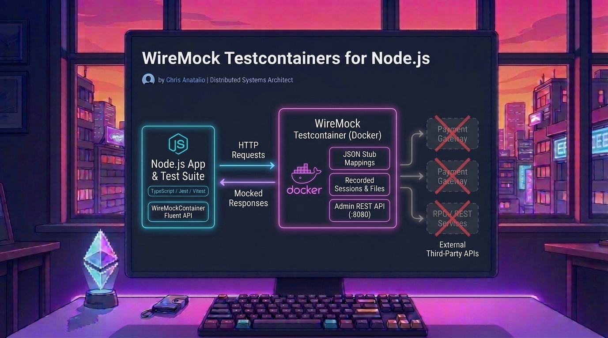

<div class="project-icon-header">
  <i class="fa-solid fa-network-wired glow-icon"></i>
  <h1>WireMock Testcontainers for Node.js</h1>
  <hr class="header-divider">
</div>

<div class="project-hero">
  
</div>

## Overview

The **WireMock Testcontainers for Node.js** module brings professional-grade API mocking to the Node.js ecosystem. By combining the power of WireMock with Testcontainers, this tool enables developers to create robust, isolated integration tests that mock external HTTP dependencies with precision and reliability.

<div class="project-badges">
  <a href="https://github.com/hella-web3/wiremock-testcontainers-nodejs" target="_blank" rel="noopener">
    
  </a>
  <a href="https://www.npmjs.com/package/@hellaweb3/wiremock-testcontainers-nodejs" target="_blank" rel="noopener">
    
  </a>
  
</div>

### Key Features

- **[Fluent, Typed Builder](https://hella-web3.github.io/wiremock-testcontainers-nodejs/docs/guides/registering-stubs)** - Register stubs from directories, files, npm packages or inline objects – validated before Docker starts
- **[Fast Test Isolation](https://hella-web3.github.io/wiremock-testcontainers-nodejs/docs/guides/test-isolation)** - One container per suite; `reset()` restores stubs, scenarios and journal in milliseconds
- **[Request Verification](https://hella-web3.github.io/wiremock-testcontainers-nodejs/docs/guides/verifying-requests)** - Assert on what your code actually sent with `countRequests()` and `findRequests()`
- **[WireMock Extensions](https://hella-web3.github.io/wiremock-testcontainers-nodejs/docs/extensions/java-extensions)** - Load compiled extension JARs with typed stub helpers – no JDK needed
- **[No Docker? Develop Anyway](https://hella-web3.github.io/wiremock-testcontainers-nodejs/docs/guides/running-without-docker)** - Serve every container from a local WireMock JVM for development
- **Response Templating** - Dynamic responses using Handlebars templates
- **Stateful Scenarios** - Model complex multi-step API interactions
- **TypeScript First** - Built with TypeScript for superior type safety and IntelliSense

<div class="docs-link-banner">
  <i class="fa-solid fa-book"></i> <strong><a href="https://hella-web3.github.io/wiremock-testcontainers-nodejs/">View Full Documentation</a></strong> - Complete guides, API reference, and working examples
</div>

<hr class="section-divider">

## Why This Matters

Modern applications depend on numerous external APIs and services. Testing these integrations reliably requires **precision, control, and consistency**. Our WireMock Testcontainers module demonstrates our dedication to:

- **Test Reliability** - No more flaky tests due to network issues or external service downtime
- **Development Velocity** - Test without waiting for staging environments or third-party sandbox APIs
- **Security Best Practices** - Test against realistic scenarios including error conditions and edge cases
- **Team Productivity** - Developers can work offline with full testing capabilities

<hr class="section-divider">

## Installation

```bash
npm install @hellaweb3/wiremock-testcontainers-nodejs
```

or

```bash
yarn add @hellaweb3/wiremock-testcontainers-nodejs
```

## Complete Test Suite Example

Here's a real-world example showing how to set up WireMock for your entire test suite:

```typescript
import { afterAll, afterEach, beforeAll, expect, it } from "vitest"; // or Jest
import { type StartedWiremockContainer, WiremockContainer } from "@hellaweb3/wiremock-testcontainers-nodejs";
import { PaymentsClient } from "../app/payments-client"; // the code under test

let wiremock: StartedWiremockContainer;

beforeAll(async () => {
  wiremock = await new WiremockContainer()
    .withMappings("./__mocks__/wiremock") // mappings/ + __files/
    .start();
  await wiremock.waitUntilReady();
}, 120_000); // the first image pull can be slow

afterEach(() => wiremock.reset()); // pristine stubs, empty journal – no restart
afterAll(() => wiremock?.stop());

it("lists the recorded payments", async () => {
  const page = await new PaymentsClient(wiremock.getUrl()).list();

  expect(page.meta.totalItems).toBe(2);
  expect(await wiremock.countRequests({ method: "GET", url: "/payments" })).toBe(1);
});
```

<div class="example-note">
  <i class="fa-solid fa-lightbulb"></i> <strong>Performance Tip:</strong> Notice the <code>reset()</code> call in <code>afterEach</code> - this restores pristine stubs and empties the request journal without restarting the container, making your test suite dramatically faster. <a href="https://hella-web3.github.io/wiremock-testcontainers-nodejs/docs/guides/test-isolation">Learn more about test isolation →</a>
</div>

<hr class="section-divider">

## Engineering Excellence

This project exemplifies our commitment to quality software engineering:

- **Battle-Tested Architecture** - Built on the proven WireMock and Testcontainers foundations
- **Comprehensive Testing** - Extensive test suite ensuring reliability
- **Clean API Design** - Intuitive, developer-friendly interfaces
- **Performance Optimized** - Fast container lifecycle with minimal overhead
- **Production-Ready** - Used in real-world projects with demanding requirements
- **Well-Documented** - Clear examples covering common use cases

<hr class="section-divider">

## Advanced Features & Use Cases

### Registering Stubs from Multiple Sources

The fluent builder API lets you register stubs from various sources:

```typescript
await new WiremockContainer()
  .withMappings("./__mocks__/wiremock")           // from recorded sessions
  .withMappingsFromFile("./stripe-stubs.json")    // from individual files
  .withMappingsFromPackage("@acme/api-mocks")     // from npm packages
  .withMapping({                                   // or inline
    request: { method: "POST", url: "/webhook" },
    response: { status: 201 }
  })
  .start();
```

[**Explore stub registration options →**](https://hella-web3.github.io/wiremock-testcontainers-nodejs/docs/guides/registering-stubs)

### Request Verification

Assert that your code made the correct HTTP calls:

```typescript
// Count specific requests
const count = await wiremock.countRequests({
  method: "POST",
  urlPathPattern: "/api/payments/.*"
});

// Find and inspect requests
const requests = await wiremock.findRequests({
  method: "GET",
  url: "/users/123"
});
```

[**Learn about request verification →**](https://hella-web3.github.io/wiremock-testcontainers-nodejs/docs/guides/verifying-requests)

### Real-World Use Cases

<div class="use-cases-grid">
  <div class="use-case">
    <h4><i class="fa-solid fa-credit-card"></i> Payment Gateway Testing</h4>
    <p>Mock Stripe, PayPal, or Square APIs to test payment flows without hitting real endpoints or incurring transaction fees.</p>
  </div>

  <div class="use-case">
    <h4><i class="fa-solid fa-lock"></i> OAuth & Authentication</h4>
    <p>Simulate OAuth providers and authentication services to test login flows, token refresh, and error scenarios.</p>
  </div>

  <div class="use-case">
    <h4><i class="fa-solid fa-cubes"></i> Microservices Integration</h4>
    <p>Validate service-to-service communication patterns in isolation before integration, including failure scenarios.</p>
  </div>

  <div class="use-case">
    <h4><i class="fa-solid fa-file-contract"></i> Third-Party API Contracts</h4>
    <p>Ensure your code correctly handles API contracts from external services, including edge cases and version changes.</p>
  </div>
</div>

<hr class="section-divider">

## Real-World Benefits

Teams integrating this module experience:
- **90% faster** integration test execution compared to hitting real APIs
- **Zero dependency** on external service availability during testing
- **Complete control** over edge cases, error conditions, and timeout scenarios
- **Simplified CI/CD** with no need for complex staging environment coordination

<hr class="section-divider">

## Resources & Documentation

<div class="resources-grid">
  <div class="resource-card">
    <h4><i class="fa-solid fa-book-open"></i> Full Documentation</h4>
    <p>Complete guides, tutorials, and API reference with tested examples that cannot drift from the actual codebase.</p>
    <a href="https://hella-web3.github.io/wiremock-testcontainers-nodejs/" class="button button--secondary button--small">View Docs →</a>
  </div>

  <div class="resource-card">
    <h4><i class="fa-solid fa-wrench"></i> API Reference</h4>
    <p>Detailed API documentation for all container methods, stub registration, and verification functions.</p>
    <a href="https://hella-web3.github.io/wiremock-testcontainers-nodejs/docs/api" class="button button--secondary button--small">API Docs →</a>
  </div>

  <div class="resource-card">
    <h4><i class="fa-solid fa-code"></i> Working Examples</h4>
    <p>Real, runnable examples covering quick start, advanced features, and common integration patterns.</p>
    <a href="https://github.com/hella-web3/wiremock-testcontainers-nodejs/tree/main/examples" class="button button--secondary button--small">View Examples →</a>
  </div>

  <div class="resource-card">
    <h4><i class="fa-brands fa-npm"></i> NPM Package</h4>
    <p>Install via npm or yarn. MIT licensed with full TypeScript support and no peer dependencies.</p>
    <a href="https://www.npmjs.com/package/@hellaweb3/wiremock-testcontainers-nodejs" class="button button--secondary button--small">View on NPM →</a>
  </div>

  <div class="resource-card">
    <h4><i class="fa-brands fa-github"></i> GitHub Repository</h4>
    <p>Source code, issue tracking, and contribution guidelines. PRs welcome!</p>
    <a href="https://github.com/hella-web3/wiremock-testcontainers-nodejs" class="button button--secondary button--small">View on GitHub →</a>
  </div>

  <div class="resource-card">
    <h4><i class="fa-solid fa-circle-exclamation"></i> Troubleshooting</h4>
    <p>Common issues, solutions, and tips for Docker, networking, and WireMock configuration.</p>
    <a href="https://hella-web3.github.io/wiremock-testcontainers-nodejs/docs/reference/troubleshooting" class="button button--secondary button--small">Troubleshooting →</a>
  </div>
</div>

**Additional Resources:**
- [WireMock Official Documentation](http://wiremock.org/docs/) - Learn about WireMock's powerful stubbing and matching capabilities
- [Testcontainers for Node.js](https://node.testcontainers.org/) - Understand the underlying container framework

---

<div class="cta-section">
  <h3>Need a high-performance testing infrastructure?</h3>
  <p>These open-source contributions represent just a fraction of our expertise in test automation, DevOps, and software quality engineering. We help teams implement comprehensive testing strategies that accelerate delivery while maintaining the highest quality standards.</p>
  <a href="/contact/" class="button button--primary">Contact Us for a Consultation</a>
</div>

<style>
/* Hide default page template elements */
.page-head {
  display: none;
}

.project-icon-header {
  text-align: center;
  margin: 3rem 0 2rem;
}

.glow-icon {
  font-size: 4rem;
  color: #667eea;
  margin-bottom: 1rem;
  display: inline-block;
  animation: glow 2s ease-in-out infinite alternate;
}

@keyframes glow {
  from {
    text-shadow: 0 0 10px #667eea, 0 0 20px #667eea, 0 0 30px #667eea;
  }
  to {
    text-shadow: 0 0 20px #667eea, 0 0 30px #764ba2, 0 0 40px #764ba2;
  }
}

.project-icon-header h1 {
  margin: 1rem 0 0.5rem;
  font-size: 2.5rem;
}

.header-divider {
  width: 100px;
  margin: 1.5rem auto;
  border: 0;
  height: 3px;
  background: linear-gradient(90deg, transparent, #667eea, transparent);
}

.section-divider {
  margin: 3rem 0;
  border: 0;
  height: 2px;
  background: linear-gradient(90deg, transparent, #e1e8ed, transparent);
}

.project-hero {
  margin: 2rem 0;
}

.project-hero__image {
  width: 100%;
  height: auto;
  border-radius: 8px;
  box-shadow: 0 4px 6px rgba(0, 0, 0, 0.1);
}

.project-badges {
  display: inline-flex;
  gap: 0.75rem;
  align-items: center;
  flex-wrap: wrap;
  margin: 1.5rem 0;
}

.project-badges img {
  height: 20px;
  vertical-align: middle;
}

.docs-link-banner {
  background: linear-gradient(135deg, #667eea 0%, #764ba2 100%);
  color: white;
  padding: 1.5rem;
  border-radius: 8px;
  margin: 2rem 0;
  text-align: center;
}

.docs-link-banner a {
  color: white;
  text-decoration: underline;
}

.docs-link-banner a:hover {
  text-decoration: none;
}

.example-note {
  background: var(--background-alt-color, #f8f9fa);
  border-left: 4px solid #4CAF50;
  padding: 1rem 1.5rem;
  margin: 1.5rem 0;
  border-radius: 4px;
}

.example-note code {
  background: rgba(0, 0, 0, 0.1);
  padding: 0.2rem 0.4rem;
  border-radius: 3px;
}

.use-cases-grid {
  display: grid;
  grid-template-columns: repeat(auto-fit, minmax(250px, 1fr));
  gap: 1.5rem;
  margin: 2rem 0;
}

.use-case {
  padding: 1.5rem;
  border: 1px solid var(--border-color, #e1e8ed);
  border-radius: 8px;
  background: var(--background-alt-color, #f8f9fa);
}

.use-case h4 {
  margin-top: 0;
  font-size: 1.1rem;
}

.resources-grid {
  display: grid;
  grid-template-columns: repeat(auto-fit, minmax(280px, 1fr));
  gap: 1.5rem;
  margin: 2rem 0;
}

.resource-card {
  padding: 1.5rem;
  border: 1px solid var(--border-color, #e1e8ed);
  border-radius: 8px;
  background: var(--background-alt-color, #f8f9fa);
  text-align: center;
}

.resource-card h4 {
  margin-top: 0;
  font-size: 1.2rem;
}

.resource-card p {
  font-size: 0.95rem;
  margin: 1rem 0;
  min-height: 60px;
}

.resource-card .button {
  margin-top: auto;
}

.cta-section {
  background: var(--background-alt-color, #f8f9fa);
  padding: 3rem 2rem;
  border-radius: 8px;
  text-align: center;
  margin: 3rem 0;
}

.cta-section h3 {
  margin-top: 0;
  font-size: 2rem;
}

.cta-section p {
  font-size: 1.1rem;
  max-width: 800px;
  margin: 1rem auto 2rem;
}
</style>

---

*Created with precision by Hella Labs - where quality meets innovation.*
